<p align="center">
    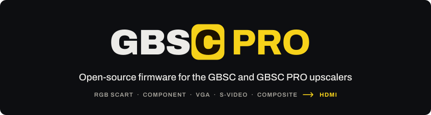
</p>

<p align="center">
    <a href="https://github.com/brisma/gbsc-pro/releases"></a>
    <a href="https://github.com/brisma/gbsc-pro/actions/workflows/test.yml"></a>
    <a href="LICENSE"></a>
</p>

Open-source firmware for the **GBSC** and the **GBSC PRO** video upscalers: analog consoles and computers in, 480p
to 1200p out, with low latency. The GBSC is the [gbs-control](https://github.com/ramapcsx2/gbs-control) upscaler, a
GBS-8200/8220 scaler board driven by an ESP8266; the GBSC PRO builds on it with a decoder for S-Video and Composite,
HDMI output, a menu chip for the TV, a remote and volume control.

Version 3 is a rewrite on top of upstream gbs-control. It finds the connected console by itself, keeps one profile
per console and loads it when that console comes back, has one menu for the TV, the OLED and the browser, and updates
itself over WiFi.

[Releases](https://github.com/brisma/gbsc-pro/releases) · [Changelog](CHANGELOG.md) ·
[Discord](https://discord.com/invite/2MMWRkVRbk) ·
[Report a problem](https://github.com/brisma/gbsc-pro/issues/new/choose)

<p align="center">
    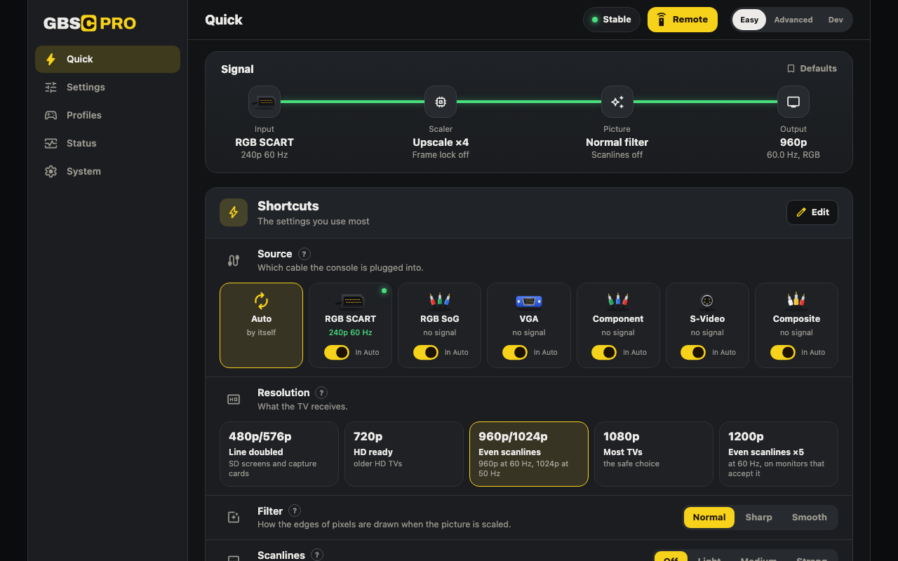
    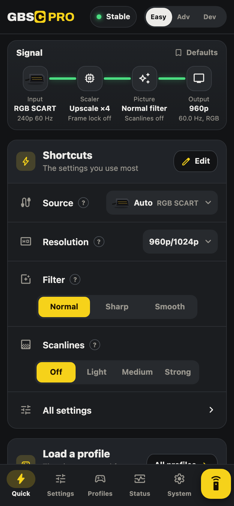
</p>

## How it works

- **GBS-Control** (ESP8266) is the firmware of both boards: the TV5725 scaler, the menus, the OLED and the knob, WiFi,
  the web app and the updates. On a GBSC it is the only one.
- **ADV Controller** (HC32F460) is the second firmware of the GBSC PRO, released together with it: the ADV7280
  decoder and the ADV7391 encoder that turn S-Video and Composite into Component for the scaler. GBS-Control sends it
  the whole state over a serial link and checks that it was applied.

The signal path of a GBSC PRO:

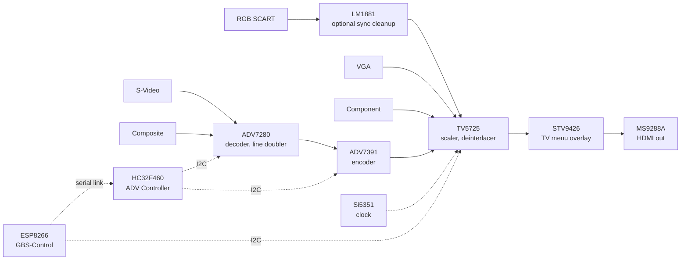

A GBSC is the same path without the decoder, the encoder, the ADV Controller and the menu chip: RGB, Component and
VGA go straight to the TV5725, which drives the VGA output.

| | GBSC | GBSC PRO |
|---|---|---|
| Inputs | RGB SCART, RGB SoG, Component, VGA | the same, plus S-Video and Composite |
| Menu on the TV | upstream's icon menu | the full menu |
| Controls | web app; OLED and knob when fitted | web app, OLED, knob and remote |
| Sound | no | volume and mute |
| Firmware | GBS-Control | GBS-Control and ADV Controller |

The schematic, the Gerber files and the datasheets of the GBSC PRO are in [hardware/](hardware/).

## What it does

**Inputs and outputs**
- RGB SCART (csync or composite sync), RGB SoG, Component (YPbPr), VGA, and on the GBSC PRO S-Video and Composite
  through the ADV7280 decoder.
- **Automatic input**: with Source on Auto (the default) the GBSC scans its inputs, tells an RGB SCART cable from a
  composite-only one before the first picture, and follows a console swap on the same cable. Each input can be left
  out of the scan.
- Output 480p/576p, 720p, 960p, 1024p, 1080p, 1200p (experimental) or Downscale; every HD output is 4:3.
- Motion-adaptive deinterlacing; **Smooth scrolling** (frame lock: the output rate follows the source's, through
  the Si5351 clock, so no frame is dropped or repeated); Always 60 Hz for PAL sources; line doubler (2X) for S-Video
  and Composite.
- **Sync cleanup** (the LM1881 separator) and **Adaptive Sync** (experimental: a steady picture on bright screens
  with composite sync).

**Picture**
- Filter (Normal, Sharp, Smooth) and sharpness, scanlines (Light, Medium, Strong), brightness, contrast, saturation,
  colour, HDMI range; decoder brightness, contrast, saturation, hue and filters for S-Video and Composite.
- Position, size and masks per signal mode.

**Menus**
- One menu, the same on the TV and on the OLED, with an **Easy** mode for the everyday items and an **Advanced** mode
  for everything, and a help line for every item.
- **Quick menu** (OK with the menu closed): profile, input, resolution, filter and scanlines in one place.
- Remote control and rotary knob; status pop-up when the signal or the profile changes; four TV themes.
- On a GBSC the full menu is on the OLED and in the web app; the TV shows upstream's icon menu.

<p align="center">
    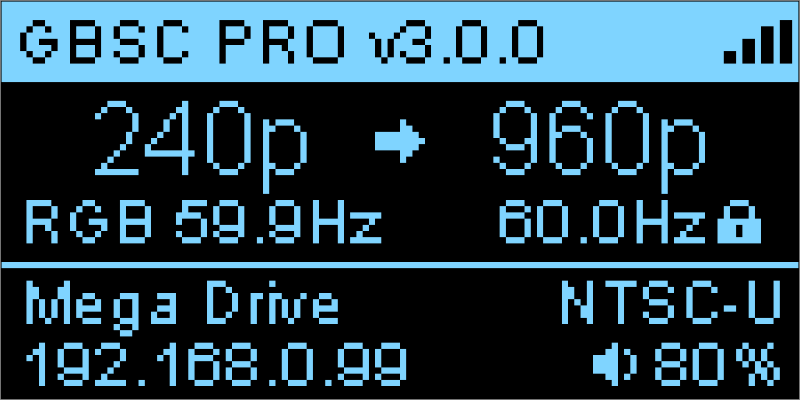
    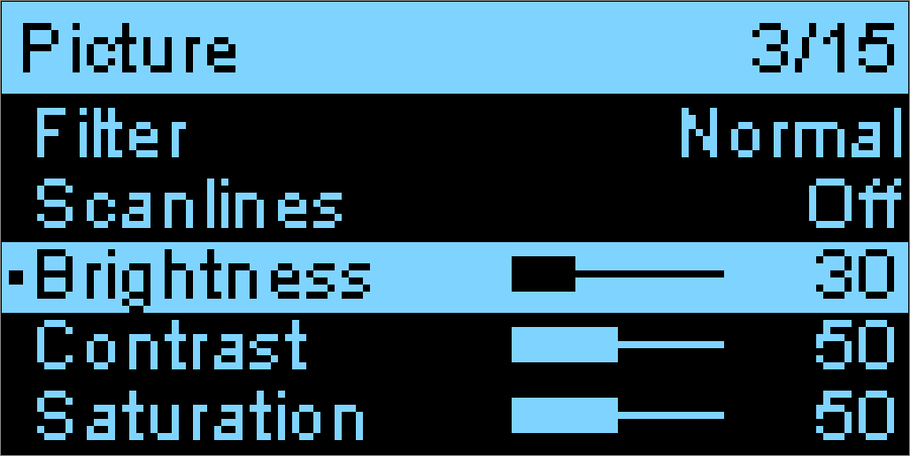
    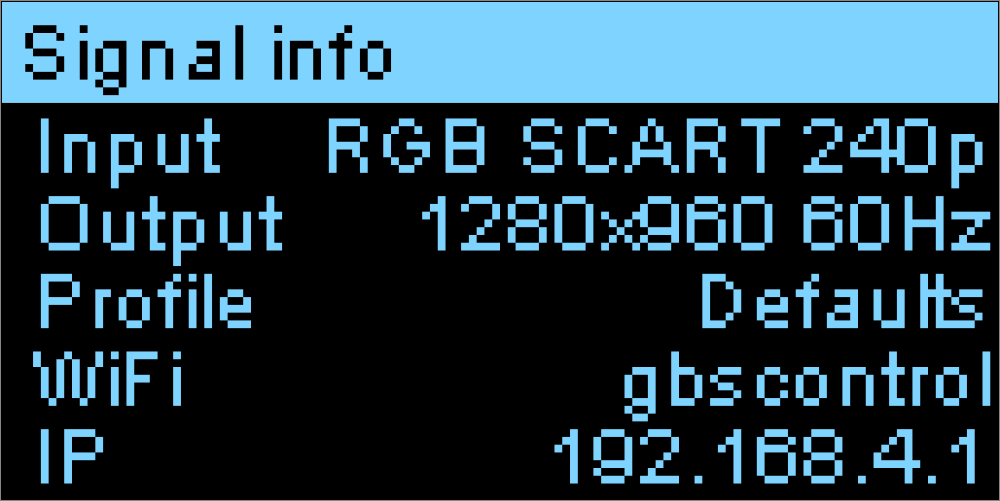
    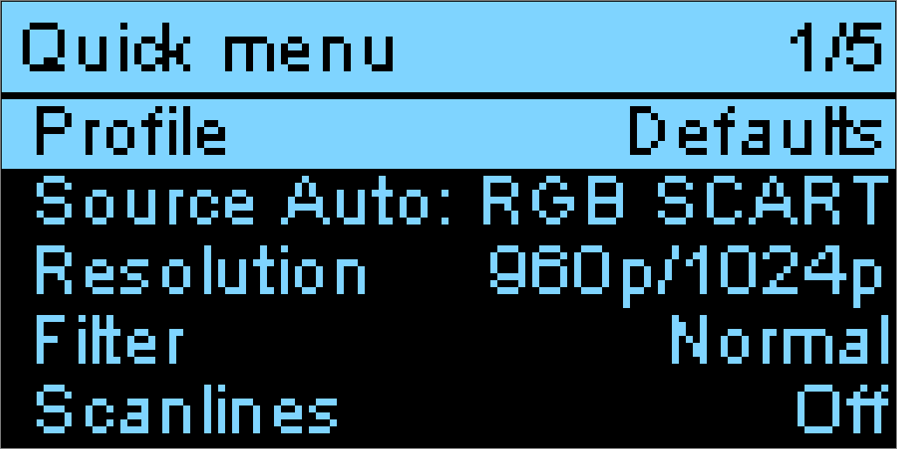
</p>

<p align="center">
    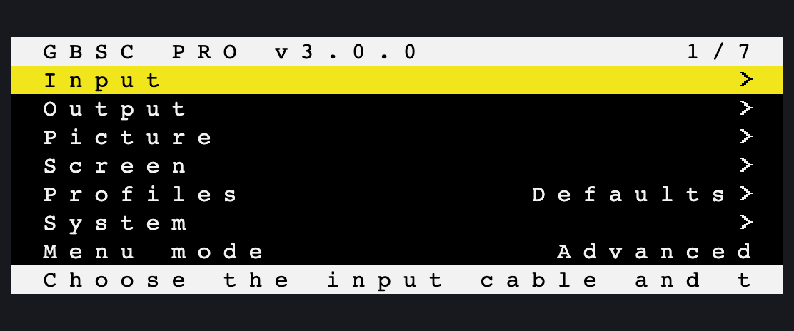
    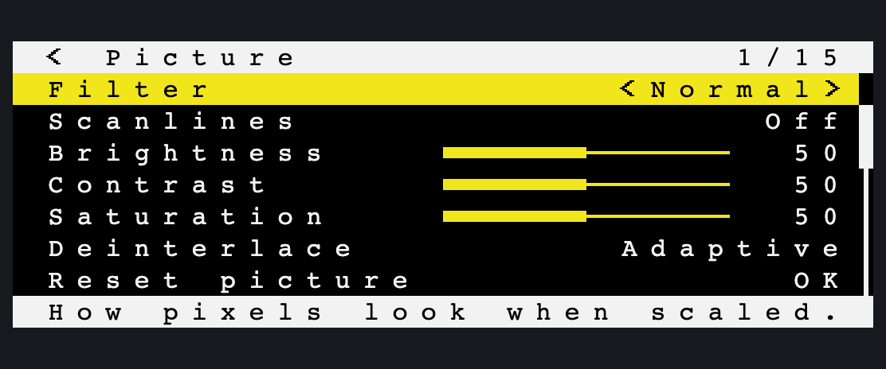
    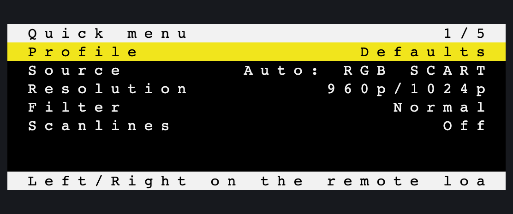
    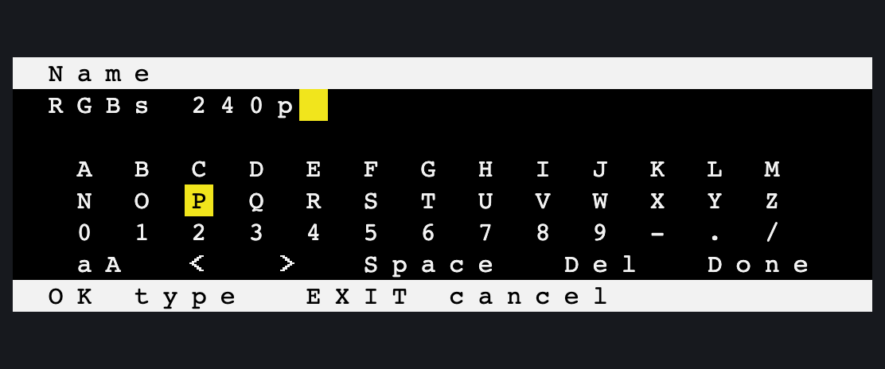
</p>

**Profiles**
- Up to 36 named profiles with a region (NTSC-U, NTSC-J, PAL, PAL60). A profile holds the picture settings and the
  scaler registers of each signal mode it was used with.
- **Auto-load**: a profile remembers the fingerprint of its signal (input, mode, line count and line rate, matched
  within 300 ppm), so a Mega Drive and a SNES on the same cable each get their own. Two consoles with the same timing
  cannot be told apart (known limits, in the [changelog](CHANGELOG.md)).
- One text file per profile: export, import, and all of them in the backup.

**Web app** (phone, tablet, PC: open `http://gbscontrol.local`)
- The same settings as the TV menu, profiles (export and import), status with the signal history and a console log,
  WiFi, updates, backup and restore, and a remote that drives the TV menu.
- One self-contained page of about 125 KB served by the ESP8266; nothing is loaded from the internet.

**WiFi**
- The scaler's memory clock disturbs the 2.4 GHz radio: **Optimize WiFi** measures it at power-on and picks the
  clock that disturbs it least.
- Requests are queued and admitted by free memory, so several browsers or fast clicking do not crash the ESP8266.

**Updates**
- Over the air from the TV menu, the OLED or the web app, on the **Stable** or **Beta** channel (see below).
- The ADV Controller is updated by GBS-Control through the internal link: no USB cable after the first install.
- Safe mode after three crash resets in a row keeps WiFi, update and backup available.

## For tinkerers

**HTTP API.** Everything the web app does goes through `/api/*`, and you can use it too. Reads are plain GETs; a POST
is form-encoded and needs the header `X-GBSC: 1`. An option is set by its name or its number.

```sh
curl http://gbscontrol.local/api/info                  # versions, board, signal, WiFi, the last crash
curl http://gbscontrol.local/api/settings              # every setting, key = value
curl http://gbscontrol.local/api/schema                # types, ranges and option names of every setting
curl -H "X-GBSC: 1" -d "input.source=S-Video" http://gbscontrol.local/api/settings
curl -H "X-GBSC: 1" -X POST http://gbscontrol.local/api/actions/system.restart
curl -o backup.txt http://gbscontrol.local/api/system/backup
```

Changes are pushed to every open page over a WebSocket on port 81. The other routes (profiles, WiFi, log, update) are
one table in [`api-route-match.h`](gbs-control/pro/api/api-route-match.h).

**Developer mode** (System > Developer menu in Advanced mode; "Dev" in the web app):
- every TV5725 register by field name, with live values;
- the ADV7280 and ADV7391 register maps with their options, plus presets and macros stored on the device as YAML;
- sync, clock and debug pages, and the console log with the device's decisions;
- after a crash, `/api/info` holds the exception address and the stack addresses for `addr2line`.

**ADV Controller console.** Plugged into a computer while it runs, the ADV Controller's USB-C port is a serial
console: register access, link and update status, a log. See [adv-controller](adv-controller/README.md).

**Settings are text.** The backup is one readable file: `key=value` settings, one section per profile, the ADV
presets and macros.

**Building it.** `python3 tools/dev.py build` builds both firmwares, natively or in the development container
(`docker compose run --rm dev build`). The menu, the scaler logic and the link are tested on the host, with
simulators of the OSD chip, the OLED and the whole device for the web app: [CONTRIBUTING.md](CONTRIBUTING.md).

**Your own update server.** A fork can publish its own builds: the files an update server must hold and how it must
answer are in [tools/ota/README.md](tools/ota/README.md).

## Getting started

### Supported hardware

| Board | What to flash |
|-------|---------------|
| GBSC PRO | GBS-Control and the ADV Controller, always from the same release |
| GBSC (gbs-control: GBS-8200/8220 + ESP8266, optional OLED, knob and Si5351) | GBS-Control only. *Not yet tested by users: reports are welcome.* |

### First install (USB)

1. Download `gbsc-pro-<version>.zip` from the [latest release](https://github.com/brisma/gbsc-pro/releases) and unzip
   it. The folder holds the firmware files and the **GBSC PRO Flasher** for macOS, Windows and Linux.
2. Open the flasher from that folder (it preselects the files next to it):
   - macOS: right-click the app, choose Open, then Open again (the app is not signed by Apple);
   - Windows: if SmartScreen warns, choose "More info", then "Run anyway";
   - Linux: `chmod +x gbsc-pro-flasher.AppImage`, and your account needs access to serial ports.
3. **GBS-Control**: connect the GBSC's USB port, choose the device and the `.bin` file, then Flash.
4. **ADV Controller** (GBSC PRO only): hold the ADV Controller's button while you plug its USB-C cable (bootloader
   mode), choose the device and the ADV Controller image, then Flash.
5. Connect to the GBSC's WiFi hotspot and open `http://192.168.4.1`, or set WiFi from the TV menu
   (System > WiFi); from then on the web app is at `http://gbscontrol.local`.

More about the flasher, its command line and backups: [gbsc-pro-flasher](gbsc-pro-flasher/README.md).

### Coming from 2.4.x

Firmware 3.0 is a rewrite. Flash **both** firmwares over USB the first time (the 2.4.x ADV Controller cannot be
updated over the link). Settings and slots are not carried over: 3.0 starts from the defaults and slots become named
profiles. The details are in the [upgrade notes](CHANGELOG.md#upgrade-notes).

### Going back to 2.4.x

Flash both files of the [2.4.1 release](https://github.com/brisma/gbsc-pro/releases/tag/v2.4.1) over USB with the GBSC
PRO Flasher (it asks to confirm files without a version marker) and choose **Erase settings and profiles** for the
ESP8266: 2.4.1 does not read the 3.0 settings. Take a backup first if you plan to return to 3.0.

### Updating

- **System > Update** on the TV, the OLED or the web app: Check now, then Install. The ADV Controller follows: a
  prompt at start-up offers its update when a newer one is built into GBS-Control.
- The web app (System > Update) also takes a firmware file you downloaded, and the flasher can update a unit over
  WiFi.

### Release channels

- **Stable**: the recommended releases.
- **Beta**: release candidates, already tested, waiting for users' feedback before they become Stable. A Beta build
  is offered the newest Beta or Stable; System > Update > Other channels moves a unit from one channel to the other
  or back to an older version.

## Hardware

The GBSC PRO is sold ready to use at the [official store](https://www.aliexpress.com/item/3256808268415575.html): that
board is the one the firmware is developed and tested on. Its design files (schematic, Gerber, BOM and datasheets) are
open, for reference, in [hardware/](hardware/). A GBSC is built from a GBS-8200/8220 board as the
[gbs-control wiki](https://github.com/ramapcsx2/gbs-control/wiki) describes.


## Contributing

Bug reports and ideas: [issues](https://github.com/brisma/gbsc-pro/issues/new/choose) or the
[Discord](https://discord.com/invite/2MMWRkVRbk). For a bug, paste the report of the web app (Status > Diagnostics >
Copy for an issue). Building the firmware, running the tests and the project's layout:
[CONTRIBUTING.md](CONTRIBUTING.md).

## Thanks

- [@ramapcsx2](https://github.com/ramapcsx2) and the contributors of [gbs-control](https://github.com/ramapcsx2/gbs-control),
  the firmware this project builds on.
- [RetroScaler](https://github.com/RetroScaler/gbsc-pro) for the GBSC PRO hardware and its first firmware releases.

## License

GBSC PRO is free software under the [GNU General Public License v3.0](LICENSE), the licence of
[gbs-control](https://github.com/ramapcsx2/gbs-control) it derives from. Third-party code keeps its own licence: the
XHSC HC32F460 drivers and USB device library (BSD 3-Clause, `adv-controller/lib/`), WebSockets and PersWiFiManager
(`gbs-control/3rdparty/`), si5351mcu (LGPL 2.1, `gbs-control/src/`), the PlatformIO libraries (ESPAsyncWebServer,
IRremoteESP8266, ThingPulse OLED driver) and the esptool flasher stub (GPL 2.0 or later,
`gbsc-pro-flasher/resources/LICENSES/`).
